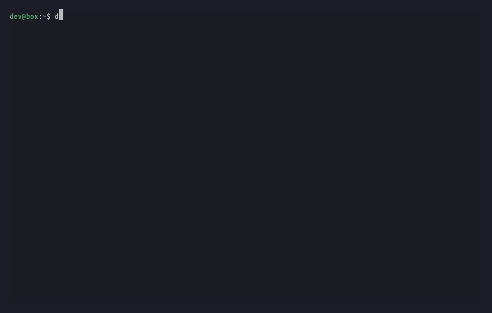

**English** | [简体中文](README.zh-CN.md)

# deeprouter

One command to point the coding tools you choose at an OpenAI- and Anthropic-compatible API gateway.

This repository is an open-source, one-command setup tool that connects Claude Code, Codex / ChatGPT desktop, Claude Desktop, Grok Build, and Gemini CLI to a compatible API gateway.

To use DeepRouter (deeprouter.top) with Claude Code, Codex, GPT, and more under a single key: first create a key on the [DeepRouter website](https://deeprouter.top/) (use your own key), then install and run `deeprouter` as described below and choose DeepRouter in the wizard. For common questions, see the [FAQ](https://deeprouter.top/faq).



## Install

> Note: The source of truth is the public repository `WiltFan/DeepRouter`. The `https://deeprouter.top` mirror below is still available if GitHub is slow or blocked.

macOS and Linux:

```sh
curl -fsSL https://raw.githubusercontent.com/WiltFan/DeepRouter/main/install.sh | sh
```

Windows PowerShell:

```powershell
irm https://raw.githubusercontent.com/WiltFan/DeepRouter/main/install.ps1 | iex
```

cmd:

```bat
powershell -ExecutionPolicy Bypass -c "irm https://raw.githubusercontent.com/WiltFan/DeepRouter/main/install.ps1 | iex"
```

`curl ... | sh` in cmd fails with `'sh' is not recognized`. `install.sh` under Git Bash or MSYS exits and prints the PowerShell command above. Windows does not use `/dev/tty`.

The command is `deeprouter`. On macOS and Linux the binary is installed to `~/.local/bin/deeprouter`. When that directory is not on `PATH`, the installer prints an `export` line and writes it into the shell startup file (`~/.zshrc`, `~/.bashrc`, or the fish config). `--no-path` skips that step. On Windows the binary is installed to `%LOCALAPPDATA%\Programs\deeprouter\deeprouter.exe`, and that directory is added to the user PATH (registry `HKCU\Environment`, keeping the existing value type). `DEEPROUTER_NO_PATH=1` or `-NoPath` skips that step.

The previous command name was `deeprouter-setup`. The installer removes the old binary from the same directory and leaves a same-named entry that runs `deeprouter`: a `deeprouter-setup` script on macOS and Linux, and `deeprouter-setup.cmd` on Windows. The old `%LOCALAPPDATA%\Programs\deeprouter-setup` directory is removed from the user PATH.

After a successful install, a controlling terminal starts interactive setup immediately, using the absolute path of the binary just installed. `install.sh` reads from `/dev/tty` because the stdin of `curl | sh` is the install script itself. `install.ps1` starts the same wizard in the current Windows console, whose stdin is not the pipe. With no controlling terminal (CI and other non-interactive sessions) it does not start the wizard, and prints the absolute path to run next. `DEEPROUTER_NO_SETUP=1` skips the automatic start as well. That launch does not depend on `PATH` already being refreshed.

Install from a checkout:

```sh
git clone https://github.com/WiltFan/DeepRouter.git
cd deeprouter
sh install.sh
```

From a Windows checkout:

```powershell
powershell -ExecutionPolicy Bypass -File .\install.ps1
```

`install.sh` is POSIX `sh` and covers macOS and Linux. `install.ps1` is the Windows installer. Next to a checkout, both compile a static binary with Go 1.22 or newer. The version baked into the binary is `git describe --tags`, or `dev` when there is no tag. An install from the network downloads a plain release binary (not an archive) and checks it against `checksums.txt` from the same place. The default host is `https://github.com/WiltFan/DeepRouter/releases/latest/download/`. If that download fails and the repository is `WiltFan/DeepRouter`, the installer tries `https://deeprouter.top/releases/latest/`. `DEEPROUTER_DOWNLOAD_BASE` selects the first host. A mirror base uses `releases/<version-or-latest>/<asset>` rather than GitHub's `releases/download/` path. That step does not call the GitHub API. The file names are `deeprouter-darwin-amd64`, `deeprouter-darwin-arm64`, `deeprouter-linux-amd64`, `deeprouter-linux-arm64`, `deeprouter-windows-amd64.exe`, and `deeprouter-windows-arm64.exe`. `DEEPROUTER_SETUP_VERSION` without a leading `v` (for example `0.1.1`) pins GitHub to `releases/download/v0.1.1/` and a mirror to `releases/v0.1.1/`. After a fork, set `DEEPROUTER_SETUP_REPO=owner/name`. Forks do not fall back to `deeprouter.top` unless `DEEPROUTER_DOWNLOAD_BASE` is set. There is no runtime dependency after install.

## Mainland China

`raw.githubusercontent.com` and GitHub release downloads are often slow or blocked in mainland China. `https://deeprouter.top` serves the installer and the release files.

macOS and Linux:

```sh
curl -fsSL https://deeprouter.top/install.sh | sh
```

Windows PowerShell:

```powershell
irm https://deeprouter.top/install.ps1 | iex
```

cmd:

```bat
powershell -ExecutionPolicy Bypass -c "irm https://deeprouter.top/install.ps1 | iex"
```

The copy of the installer on GitHub tries GitHub first, then `https://deeprouter.top`. The copy served by the mirror tries the mirror first, then GitHub. Each file from the first host gets 45 seconds and each file from the second gets 120 seconds, in both `install.sh` and `install.ps1`. Either way the script prints which host it used, and it still checks `checksums.txt`. A checksum mismatch, or an HTML page instead of a binary, counts as a failed download and moves on to the next host. `install.ps1` turns on TLS 1.2 for that session first, because older Windows PowerShell does not offer it by default. `DEEPROUTER_DOWNLOAD_BASE=https://deeprouter.top` forces the mirror first.

The server should serve the tree from `sh scripts/mirror-layout.sh --version v0.3.3` (upload the contents of `dist-mirror/` to the site root):

| URL | What it is |
| --- | --- |
| `https://deeprouter.top/install.sh` | installer, mirror host by default |
| `https://deeprouter.top/install.ps1` | Windows installer, mirror host by default |
| `https://deeprouter.top/releases/latest.txt` | one line, `v0.3.3` and a newline |
| `https://deeprouter.top/releases/latest/<asset>` | same bytes as the version directory |
| `https://deeprouter.top/releases/v0.3.3/<asset>` | `checksums.txt` and the six binaries |

`<asset>` is `checksums.txt`, `deeprouter-darwin-amd64`, `deeprouter-darwin-arm64`, `deeprouter-linux-amd64`, `deeprouter-linux-arm64`, `deeprouter-windows-amd64.exe`, or `deeprouter-windows-arm64.exe`. `latest/` is a real copy, not a symlink. The installer does not read `latest.txt`.

After you agree to install missing CLIs with npm, if npmjs.org may be slow, the wizard mentions `npm config set registry https://registry.npmmirror.com` and can pass `--registry https://registry.npmmirror.com` for that one install. It does not change npm's saved config. Run the `npm config set` command yourself if you want it for later installs.

## Quick start

```sh
deeprouter
```

Running it in a terminal with no arguments goes straight to the program list of the interactive setup described below:

```text
DeepRouter
Choose which programs to configure. Press Enter for Codex / ChatGPT.
Example: 1,2
1) Codex / ChatGPT   Codex CLI and ChatGPT desktop app share ~/.codex/config.toml
2) Claude Code       ~/.claude/settings.json
3) Claude Desktop    Chat, Cowork, and the Code tab (configLibrary)
4) Gemini CLI        ~/.gemini/settings.json
5) OpenCode          ~/.config/opencode/opencode.json(c)
6) Pi Coding CLI     ~/.pi/agent/
7) Grok Build        ~/.grok/config.toml
8) Image Skill       optional: install the image Skill, then set its own image address, token, and model
Programs [1]:
```

Enter selects Codex / ChatGPT only, exactly as before; it installs no Skill, writes no image config, and does not fetch image models. `8` is the optional [image Skill](#image-skill-address-and-token) item. Chosen alone it skips program setup; chosen with programs (for example `1,8`) it runs after their setup. Its address, token, and model are its own: they never replace the program token, and program setup is not needed first. Ctrl-D or Ctrl-C at the list writes nothing. The Image Skill row appears only in the no-argument program menu. `install.sh` and `install.ps1` start `deeprouter` after install when a controlling terminal is present. Only the tools you select are changed.

The interface is Simplified Chinese unless the locale is clearly English: `LC_ALL`, or `LANG` when `LC_ALL` is empty, is `en`, `en_US.UTF-8`, `en-GB`, or similar. `C`, `POSIX`, and an empty locale stay Chinese. `--lang en` or `DEEPROUTER_LANG=en` selects English, and `--lang zh` or `DEEPROUTER_LANG=zh` selects Chinese, whatever the locale says. An unknown `DEEPROUTER_LANG` value is ignored. The same rule covers every command, including `setup`, `test`, and their errors, and both installers. The examples below show the English text, with the Chinese where it helps.

When stdin is not a terminal (`deeprouter </dev/null`, or a pipe), there is no menu and the wizard does not read the input as answers. It prints `Run deeprouter in a terminal.` (Chinese: `请在终端中运行 deeprouter。`) and tells you to set `DEEPROUTER_API_KEY` or use `deeprouter setup --api-key-stdin`. It sends no request, writes nothing, and exits with code 2.

1. Choose programs. This is the first question. More than one is allowed. The prompt shows `Example: 1,2` and `Programs [1]:` (Chinese: `多选示例：1,2（英文逗号、中文逗号、顿号或空格都可以分隔）` and `程序 [1]:`). Enter selects Codex / ChatGPT. Separators are a comma, a space, a full-width comma (`，`), an ideographic comma (`、`), or a full-width space. Codex CLI and the ChatGPT desktop app share `~/.codex/config.toml`, so the list has one entry for both. A selection with no configurable program asks again. After configuration, the wizard reports CLI discovery and, where relevant, desktop presence separately. A missing client gets official install guidance. The lookup uses `PATH` and standard bin directories.
2. Choose a platform for those programs. The prompt is `Platform [1]:` (Chinese: `平台 [1]:`). DeepRouter (`https://deeprouter.top`), WolfAI (`https://wolfai.top`), and LinkMesh (`https://www.linkmesh.org`) are always listed, because each of them supports every client. An official API is listed only when every selected program can use it: OpenAI (`https://api.openai.com`) for Codex / ChatGPT, OpenCode, and Pi, Anthropic/Claude (`https://api.anthropic.com`) for Claude Code, Claude Desktop, OpenCode, and Pi, Google Gemini (`https://generativelanguage.googleapis.com`) for Gemini CLI, OpenCode, and Pi, and xAI Grok (`https://api.x.ai`) for Codex / ChatGPT, OpenCode, Pi, and Grok Build. Selecting Codex and Claude together leaves only those three gateways. A custom base URL is always last. Enter selects DeepRouter. `DEEPROUTER_PROVIDER=wolfai` (or `linkmesh`, `openai`, `anthropic`, `gemini`, `xai`) highlights that platform when it is in the list; otherwise Enter stays on DeepRouter. OpenAI and xAI write Codex with `wire_api = "responses"` and a `base_url` that includes `/v1`. Anthropic/Claude writes `ANTHROPIC_BASE_URL` as the origin, with no `/v1`. Google Gemini writes `GOOGLE_GEMINI_BASE_URL` as the origin; the CLI appends `/v1beta`. Those presets check the token first and do not fetch a model list. Existing clients keep their default unless a setup flag names a model. OpenCode and Pi require a concrete model. An existing Codex model line is kept, and the wizard says which model that is.
3. Gateway URL, for the custom platform only. The prompt is `Gateway URL (Enter for https://deeprouter.top, or any compatible endpoint):` (Chinese: `网关地址（直接回车使用 https://deeprouter.top，或填写其他兼容接口）：`). Any compatible endpoint is accepted. A bad URL asks again. When the model list cannot be loaded from that URL, the wizard asks for the URL again (`Gateway URL (Enter to try … again):`). Every preset, including the official APIs, skips this question and uses that platform's URL.
4. **Each selected program** gets its own token and model questions. The prompt names the platform, for example `Enter the WolfAI token (create one at wolfai.top) for Codex / ChatGPT: ` (Chinese: `请输入 WolfAI 的令牌（在 wolfai.top 创建），用于 Codex / ChatGPT：`). A custom gateway names its URL instead: `Enter the gateway token (https://gateway.example.com) for Codex / ChatGPT: ` (Chinese: `请输入该网关的令牌（https://gateway.example.com），用于 Codex / ChatGPT：`). A key saved for another platform is not offered. An existing key for this same platform is shown in brackets, as in `… for Codex / ChatGPT [sk-****Mc04]: `, and Enter keeps it (`Kept (sk-****abcd, 51 chars)`). Each typed character echoes as `*`. After submit the wizard prints `Entered (sk-****abcd, 51 chars)`. A later program with no saved key asks `Claude Code token (Enter to reuse sk-****Mc04): ` (Chinese: `Claude Code 令牌（直接回车沿用 sk-****Mc04）：`); Enter uses the token chosen for the previous program and prints `Reused (sk-****abcd, 51 chars)`. An empty answer prints `The token is empty. Enter it again.` (Chinese: `令牌不能为空，请重新输入。`) and asks again.

   The token is checked before anything else: the wizard fetches the model list and sends tiny test requests. A 401 or 403 prints the gateway's reason, for example `The gateway rejected this token (401). Gateway said: Invalid token` (Chinese: `网关拒绝了这个令牌（401）。网关返回：Invalid token`), or `The gateway refused this token (403): no quota left, or no access.`, and asks for the token again. The test requests probe up to eight of the family's chat models at once, newest version first, each with a short timeout. A gateway recommendation does not jump ahead of a newer id, so gemini-3.8-flash is tried before gemini-2.5 even when the list starts with the older id. A model that times out is skipped and does not make the others wait. GPT models older than gpt-5.4 (gpt-4.x and gpt-5.0 through gpt-5.3, including names such as gpt-4.1-mini) are not candidates. gpt-5.4, gpt-5.4-mini, and anything newer stay in. Codex sends the same request Codex uses, POST /v1/responses with reasoning.effort set to medium, so a model that rejects that parameter fails here and is skipped. A model that fails is reported, for example `Skipped gpt-5.5: 503 No channel. Gateway said: …` (Chinese: `已跳过 gpt-5.5：503 没有可用渠道。网关返回：…`), and left out of the list. The model question looks like this:

   ```text
   Codex / ChatGPT model (Enter does not set a model; the client keeps its own default):
     1) Do not set a model (use the client default)
     2) gpt-5.5  (answered a test request)
     3) gpt-5.4  (answered a test request)
   Codex / ChatGPT model [1]:
   ```

   You can also type a model id that is not in the list, and its name does not have to contain `gpt` or `claude`. It is saved only after it answers a real test request on the route its program calls: `POST /v1/responses` for Codex / ChatGPT, `POST /v1/messages` for Claude Code and Claude Desktop. A timeout, an HTTP error, or an HTTP 200 answer that is empty or carries an error counts as a failure: nothing is saved, existing config files keep their bytes, and the question is asked again. A yes/no answer such as `n` or `yes`, spaces, and control characters are not accepted as ids. The same rule applies to the `--*-model` flags, and `--skip-verify` does not skip it.

   Grok Build does not offer that first option. Its list starts with the models that answered, newest first, and Enter selects the first of them. The word `default` is not accepted. When none answered, type a model id; Enter alone does not leave the model unset. `deeprouter setup --apps grok` without `--grok-model` writes that newest model. If none answered, setup exits 1 and writes nothing. Claude Code, Claude Desktop, Gemini CLI, and Codex / ChatGPT keep option 1. Official presets still skip the model question and leave Grok Build's model unset, because they do not fetch a model list.

   OpenCode and Pi use the model flow documented in their section below. For the other clients, official presets skip the model question and check the token first. A refused token asks again and writes nothing. That includes HTTP 401, HTTP 403, and a provider response that says the key is invalid, such as Gemini HTTP 400 `API_KEY_INVALID` or xAI HTTP 400 incorrect API key. `--skip-verify` does not accept a refused token. If the official API cannot be reached (no response, or a timeout), the wizard warns that these sites need a reachable network (from mainland China, usually a network outside China) and asks `Continue and write the config without checking the token? [y/N]` (Chinese: `不检查令牌，继续写入配置？[y/N]`). A response from the server is not that case, and the overseas-network hint is not shown. No writes nothing and exits 1, and says to check the network or proxy and run setup again. A run without a terminal is the one that mentions `--skip-verify`. When an existing Codex model line is kept, the wizard says that model is kept. Otherwise it prints that the client keeps its own default. When Codex / ChatGPT already has a root `model` line, option 1 is `Keep the existing model gpt-5` (Chinese: `保留已有模型 gpt-5`) and Enter keeps that line. Otherwise option 1 is `Do not set a model (use the client default)` (Chinese: `不指定模型（使用客户端默认）`). Every model that answered is marked `（已通过测试）` in Chinese. Option 1, Enter, or the word `default` writes no model. For Codex / ChatGPT that leaves an existing root `model` line unchanged. For the other programs except Grok Build it removes a model line written earlier, so the program uses its own default. Every listed model answered a test request. When none answered, the prompt says timed-out and failed models were skipped, the list is only option 1, and a typed id is tested once, including an id that just timed out. A listed id can also be typed. Anything else, such as `n`, `yes`, or a number outside the list, prints `That is not a model id. Enter a listed number, a listed id, or press Enter.` (or `Model 99 is out of range. …`) and asks again. When the gateway lists no model of that family, Enter leaves the model unset and a typed id is accepted. Image, video, audio, embedding, speech, and moderation models are omitted, including ids containing image, nano-banana, dall-e, sora, veo, imagen, embedding, tts, whisper, audio, realtime, moderation, flare, or sunburst. Type or capability fields on the model object win over the id. If a family is filtered down to nothing, the picker falls back to that family's unfiltered list. One key fetches the model list once, and each family is tested once per key.
5. Before anything is written, the wizard lists the files it will change and prints `A backup is saved first. Undo with: deeprouter restore` (Chinese: `修改前会留下备份。撤销请运行：deeprouter restore`). It then writes. There is no `Continue? [Y/n]` question. `deeprouter setup` does the same: it prints the file list and the restore command, and writes without asking. The terminal wizard does not edit the shell startup file, except for Gemini CLI, which reads its key and base URL from the environment. GUI apps on macOS do not read `~/.zshrc`.
6. The files are written and, for a DeepRouter-style gateway, the connectivity test runs for the selected programs. Official presets do not run that model-list probe; the token was already checked. A program with no model set is tested with a model that answers, shown as `gpt-5.4  (test only, not saved)` (Chinese: `（仅用于测试，未写入配置）`); that id is not written. If the test fails, the wizard says that the files were already written and offers `1) Pick another model` and `2) Roll back the files just written` (`Choice [2]:`). `1` asks again for the model of each program whose check failed, writes it, and runs the test again. Enter, `2`, or Ctrl-D rolls back to the files from before this run and exits with code 1.
7. If an npm CLI among the selected programs is missing, the wizard looks for `npm` first. When `npm` is not on `PATH`, it does not ask about installing with npm or about npmmirror. It prints how to install Node.js, which includes npm (`https://nodejs.org/`), and the wizard still exits 0. When `npm` is present, it asks `Install missing CLIs with npm? [y/N]` (Chinese: `用 npm 安装缺少的命令行工具？`). Anything other than `y` installs nothing. After a yes, when npmjs.org may be slow (a mainland-China locale or time zone, or npmjs.org not answering), the wizard mentions `npm config set registry https://registry.npmmirror.com` and asks `Use https://registry.npmmirror.com for this install only?`. Both questions default to no (`[y/N]`), including in a mainland-China locale. Before the install question, the wizard prints the exact `npm install -g` command. A yes to the mirror question adds `--registry` for that one install and says that this does not change the saved npm config. The wizard never runs `npm config set`.

Ctrl-D at any question before the write cancels with `Setup cancelled. Nothing was written.` and exit code 2. Ctrl-D on the token question after that token was already rejected is the exception: it exits 1 with `The token was rejected. Nothing was written.` (Chinese: `令牌被拒绝。没有写入配置。`) and does not print the cancel line. Ctrl-C before the write prints the cancel line and exits with code 130. Ctrl-C after the write, before the connectivity test has passed, rolls back the files just written and exits with code 130. After the test has passed, Ctrl-C (for example at the npm question) keeps the files and says so.

Scripts use `setup` and flags:

```sh
export DEEPROUTER_API_KEY=sk-your-key
deeprouter setup
deeprouter setup --provider wolfai
deeprouter setup --provider linkmesh --base-url https://example.com
deeprouter setup --provider openai
deeprouter setup --provider anthropic
deeprouter setup --provider gemini
deeprouter setup --provider xai --apps codex,grok
deeprouter setup --apps codex,claude-code
deeprouter setup --apps grok --grok-model grok-4 --grok-key "$GROK_KEY"
deeprouter test
```

Each preset has its own token. In a terminal, `setup` with no key asks once and names the site, for example `Enter the WolfAI token (create one at wolfai.top): ` (Chinese: `请输入 WolfAI 的令牌（在 wolfai.top 创建）：`). A key saved for another provider is not reused. `DEEPROUTER_API_KEY` is the DeepRouter token only. LinkMesh is a separate gateway: connectivity checks call `/v1/models` and the chat routes, not new-api `/api/status`.

LinkMesh (`https://www.linkmesh.org`) runs sub2api. Without a key, `POST /v1/chat/completions`, `POST /v1/responses`, and `POST /v1/messages` answer 401 `API_KEY_REQUIRED`, and `POST /v1beta/models/{model}:generateContent` answers 401 in Gemini's error shape. `POST /v1/models/{model}:generateContent` is 404, so Gemini is pointed at the origin and the CLI calls `/v1beta`. Codex uses `wire_api = "responses"` and `base_url` `https://www.linkmesh.org/v1`. Claude Code and Claude Desktop use `https://www.linkmesh.org` with no `/v1`. Grok Build uses the chat-completions route. All five programs are written. A program whose route is missing is skipped, with a message such as `LinkMesh does not expose POST /v1/messages, so Claude Code is skipped.`

`setup` without `--apps` writes the provider's default program: Codex / ChatGPT for the gateways, OpenAI, and xAI; Claude Code and Claude Desktop for Anthropic; Gemini CLI for Google Gemini. Enter on the wizard's program list is always Codex / ChatGPT, because that question comes before the platform. `--apps` writes only the listed programs, and `--claude-only` writes Claude Code and Claude Desktop. `--claude-only` and `--codex-only` cannot be combined with `--apps`. `setup` does not edit the shell startup file, except for Gemini CLI. A model flag that is left out writes no model, the same as `default`. Codex / ChatGPT keeps an existing root `model` line in that case. An explicit model id replaces it. The closing hint mentions the shell startup file only when this run wrote one. If an npm global command is installed but its directory is not on `PATH`, the hint shows how to add that directory and the full path.

Before it writes anything, `setup` checks the token on a DeepRouter-style gateway: `Checking the token at <gateway> ...` (Chinese: `正在确认 <网关> 的令牌……`), then the model list and one tiny request per program. Official presets (`openai`, `anthropic`, `gemini`, `xai`) send one request to the vendor models endpoint and do not offer a model list. OpenAI and xAI use `Authorization: Bearer`. Gemini uses `x-goog-api-key`. Anthropic uses `x-api-key` and `anthropic-version`, not `Authorization`. A 200 means the token was accepted. A refused token prints that it was rejected, writes nothing, and exits 1. That includes HTTP 401, HTTP 403, and a provider response that says the key is invalid, such as Gemini HTTP 400 `API_KEY_INVALID` or xAI HTTP 400 incorrect API key. The token is not printed. `--skip-verify` does not override a refused token. If the official API cannot be reached (no response, or a timeout), setup says that these APIs need a network that can reach them (from mainland China, usually a network outside China). A response with some other HTTP status is not a network problem, and that hint is not shown. In a terminal it asks whether to continue. Without a terminal it exits 1 unless `--skip-verify` is set. A model flag is stored as given. When Codex already has a root `model` line and the flag is omitted, setup says that model is kept. A 401 or 403, or a model passed with a `--*-model` flag that does not answer, prints the gateway's reason with `Nothing was written.` (Chinese: `没有写入配置。`) and exits with code 1. A program with no model set is tested with a model that answers, and that id is not written; when none answers, `setup` says so and writes anyway. Grok Build is the exception: the newest model that answered is written, and when none answered nothing is written. When the gateway cannot be reached at all, `setup` says that the token was not confirmed, writes the configuration anyway, and suggests `deeprouter test` for when the gateway is reachable.

## Commands

| Command | What it does |
| --- | --- |
| `setup` | Write the selected programs for one profile |
| `test` | Check the programs saved on the active profile: `GET /v1/models`, then one single-token request per program. Codex / ChatGPT uses `POST /v1/responses`, Claude Code and Claude Desktop `POST /v1/messages`, Grok Build `POST /v1/chat/completions`, and Gemini CLI `POST /v1beta/models/{model}:generateContent` with the `x-goog-api-key` header. A program with no model set is tested with a chat model of its family that answers, marked `(test only, not saved)`. Image, video, audio, embedding, speech, and moderation ids are not used for that; the unfiltered list is the fallback when the chat filter leaves nothing. Prints HTTP status, time to first byte, and total time |
| `models` | List model ids on the gateway |
| `switch` | Switch profile, or change one program's model |
| `profile list\|add\|use\|remove` | Named profiles. One profile stores one API key |
| `status` | Active profile, which tools are wired, and whether `claude` and `codex` are installed (with versions) |
| `restore` | Put changed files back from a backup |
| `uninstall` | Restore those files. `--purge` also deletes `~/.deeprouter` |
| `skill` / `skill install` | Install the DeepRouter image Skill into Codex and Claude Code, or optionally Claude Desktop (Code tab), Grok Build, Gemini CLI, OpenCode, and Pi. See [Image Skill](#image-skill) |
| `version` | Print the version |

`deeprouter <command> --help` lists flags. `test` and `models` accept `--json`. `--lang zh` or `--lang en` works with every command and with the wizard.

Exit codes: `0` success. A wizard that cannot find `npm` still exits 0 after printing how to install Node.js. `1` a gateway check failed, the token was refused, an official API could not be reached and `--skip-verify` was not set, a file write failed, the wizard rolled back its write, `setup --install-clis` could not find `npm`, or Ctrl-D was pressed on the token question after that token was already rejected. `2` the command line is wrong, setup was cancelled before the write (Ctrl-D, except the rejected-token re-prompt), or the wizard was started without a terminal. `130` Ctrl-C.

## Non-interactive flags

```sh
deeprouter setup \
  --base-url https://deeprouter.top \
  --apps claude-code,claude-desktop,codex,grok \
  --api-key "$DEEPROUTER_API_KEY" \
  --claude-model claude-sonnet-5-5 \
  --claude-desktop-model claude-opus-5-5 \
  --codex-model gpt-6.1-sol \
  --grok-model grok-4 \
  --claude-code-key "$CLAUDE_KEY" \
  --claude-desktop-key "$DESKTOP_KEY" \
  --codex-key "$CODEX_KEY" \
  --grok-key "$GROK_KEY"
```

| Flag | What it does |
| --- | --- |
| `--provider NAME` | `deeprouter` (default, `https://deeprouter.top`), `wolfai` (`https://wolfai.top`), `linkmesh` (`https://www.linkmesh.org`), `openai` (`https://api.openai.com`), `anthropic` (`https://api.anthropic.com`), `gemini` (`https://generativelanguage.googleapis.com`), or `xai` (`https://api.x.ai`). `DEEPROUTER_PROVIDER` selects the same preset. `--base-url` overrides the URL and keeps this id. Codex writes `model_provider = "<id>"` and `[model_providers.<id>]`. Grok Build writes `[model.<id>]`. Configuring again removes the previous managed section (`deeprouter`, `wolfai`, `linkmesh`, `openai-api`, `anthropic`, `gemini`, `xai`, or `custom`) and leaves unrelated tables alone. `[model_providers.openai]` is not one of those sections. The four official names check the token, do not offer a model list, and are offered only for the clients that speak that API. `--skip-verify` writes when that check cannot reach the API. A refused token, including a provider HTTP 400 that says the key is invalid, still writes nothing. `install.sh` and `install.ps1` pass `--provider` and `DEEPROUTER_PROVIDER` through to setup |
| `--apps LIST` | `codex`, `claude-code`, `claude-desktop`, `gemini`, `opencode`, `pi`, `grok`, separated by commas or spaces |
| `--api-key` / `--api-key-stdin` / `DEEPROUTER_API_KEY` | Shared key. Used for any program that has no key of its own |
| `--claude-code-key`, `--claude-desktop-key`, `--codex-key`, `--grok-key`, `--gemini-key` | Written only to that program. Omitted flags use the shared key |
| `--claude-model`, `--claude-desktop-model`, `--codex-model`, `--grok-model`, `--gemini-model` | Model id for that program, checked with one tiny request before anything is written. A model that does not answer stops `setup` with exit code 1 and writes nothing. When the flag is omitted, or is `default`, no model is written, except `--grok-model`: omitting it on a gateway writes the newest Grok Build model that answered a test request, and `default` is rejected. Codex / ChatGPT leaves an existing root `model` line unchanged; pass a model id to replace it. The other programs except Grok Build remove a model line written earlier so the program uses its own default: Claude Code loses `ANTHROPIC_MODEL` and Gemini CLI `model.name`. Claude Desktop loses a single-entry `inferenceModels` and gets `modelDiscoveryEnabled`; a list of more than one model is left alone. `--claude-model` also applies to Claude Desktop when `--claude-desktop-model` is not given |
| `--no-shell` | Kept for older scripts. `setup` edits the shell startup file only for Gemini CLI, and `--no-shell` does not skip that, because Gemini CLI reads `GEMINI_API_KEY` and `GOOGLE_GEMINI_BASE_URL` from the environment |
| `--claude-only` | Write Claude Code and Claude Desktop, and skip Codex / ChatGPT. Cannot be combined with `--apps` |
| `--codex-only` | Write only Codex / ChatGPT |

`--api-key` shows up in the process list. Scripts should use `DEEPROUTER_API_KEY` or `--api-key-stdin`.

`switch` updates only the programs that were actually written last time. A profile that only configured Grok Build does not touch Claude Code or Codex / ChatGPT on switch. Models can be changed on their own with `--claude-model`, `--claude-desktop-model`, `--codex-model`, `--grok-model`, and `--gemini-model`.

## Profiles

A profile stores the gateway URL, the API key, and optional model ids. The name is yours. There is no official-key group.

```sh
deeprouter setup --api-key "$DEEPROUTER_API_KEY"
deeprouter profile add azure --label Azure --api-key "$AZURE_KEY"
deeprouter switch --profile azure
```

Switching profiles rewrites the files configured last time. Running again replaces them in place. It does not append a second block to `~/.zshrc`, and it does not write the same key twice.

## Where each program is written

The model ids below are examples. Use an id your gateway actually lists. A model line is written only when you pick a model in the wizard or pass a `--*-model` flag; by default it is left out. `--base-url` may include `/v1` or not: Claude receives the URL without a trailing `/v1` (the client requests `/v1/messages` itself), and Codex / ChatGPT and Grok Build receive the URL with `/v1`.

### Claude Code

`~/.claude/settings.json` (on Windows, `%USERPROFILE%\.claude\settings.json`). Other keys are kept. File mode `0600`. Environment variables here take priority over the shell.

```json
{
  "env": {
    "ANTHROPIC_BASE_URL": "https://deeprouter.top",
    "ANTHROPIC_AUTH_TOKEN": "sk-your-key",
    "ANTHROPIC_MODEL": "claude-sonnet-5-5"
  }
}
```

The Code tab inside Claude Desktop does not use this file for the gateway.

### OpenCode and Pi Coding CLI

Select OpenCode or Pi in the wizard, choose DeepRouter, WolfAI, LinkMesh, or a custom address, then choose a protocol and model for each client. On gateways the wizard filters catalog suggestions for text models and the selected protocol. You can type an unlisted model ID even when no catalog is available. Setup probes the chosen model on the selected route. Official OpenAI and xAI offer the two OpenAI protocols, while official Anthropic and Gemini offer their respective native protocols.

Use `--apps opencode,pi` with `--opencode-model ID` and `--pi-model ID` for first-time non-interactive setup. Select protocols with `--opencode-protocol NAME` and `--pi-protocol NAME`. Both default to `openai-completions` on gateways and keep saved choices on repeat setup for the same provider. `switch` and `profile add` accept the model and protocol flags. For a custom address use `--provider custom --base-url URL`. Per-client keys `--opencode-key` and `--pi-key` default to the setup key. Use raw model IDs such as `vendor/model` without the configured provider prefix. For Gemini, an optional leading `models/` is stripped because the adapter adds the path.

| Protocol flag and Pi `api` | OpenCode native package under `@opencode/ai/providers/` | OpenCode `baseURL` | Pi `baseUrl` |
| --- | --- | --- | --- |
| `openai-completions` (default) | `openai-compatible` | `/v1` | `/v1` |
| `openai-responses` | `openai-compatible/responses` | `/v1` | `/v1` |
| `anthropic-messages` | `anthropic-compatible` | `/v1` | no version suffix |
| `google-generative-ai` | `google` | `/v1beta` | `/v1beta` |

The suffixes are relative to the normalized gateway address and preserve any gateway path prefix. OpenCode's Anthropic adapter appends `/messages`, while Pi's appends `/v1/messages`. Both Gemini adapters take a versioned base. The mappings use the official client schemas and DeepRouter's existing URL splitting. **Live OpenCode and Pi calls were not verified in this batch.** Catalog suggestions do not establish protocol compatibility. [OpenCode provider packages](https://opencode.ai/docs/providers/) · [Pi models schema](https://docs.pi.dev/latest/models-configuration)

- OpenCode CLI and Desktop with a local server share `~/.config/opencode/opencode.json(c)` (`%USERPROFILE%\.config\opencode\opencode.json(c)` on Windows). `XDG_CONFIG_HOME`, `OPENCODE_CONFIG_DIR`, and `OPENCODE_CONFIG` override the path. When both files exist in the selected config directory, setup edits only `opencode.jsonc`. Setup merges the existing `providers` or `provider` layout and selects `provider-id/model-id`. It preserves JSONC comments and trailing commas and refuses invalid syntax or duplicate keys. Start a new CLI session or reopen Desktop when it uses a local server. Desktop connected to another server uses that server’s config.
- Pi reads `~/.pi/agent` (`%USERPROFILE%\.pi\agent` on Windows) or `PI_CODING_AGENT_DIR`. DeepRouter merges `models.json`, stores the token in private `auth.json`, and sets the default provider and model in `settings.json`. Start a new session for the saved default or open `/model` to reload models. [Pi configuration](https://docs.pi.dev/latest/configuration)

The single `Codex / ChatGPT` connection entry uses the same `codex` configuration for Codex CLI and Codex mode in the ChatGPT desktop app. Work mode may also use this configuration on some current ChatGPT desktop clients. Compatibility across all client versions and modes remains unverified.

### Claude Desktop (Chat, Cowork, and Code tabs)

Claude Desktop is one app. Claude Code inside it is the Code tab, not a second desktop program. In the official docs, desktop gateway routing comes from third-party inference configuration. It does not read `ANTHROPIC_BASE_URL` or `settings.json`. Chat, Cowork, and Code share that configuration. The gateway fields are passed into every Code session and cannot be overridden by `~/.claude/settings.json`.

With no managed configuration, the app stores local config under `configLibrary/` in the third-party app data directory ([User identity and local data](https://claude.com/docs/third-party/claude-desktop/data-storage)):

| Platform | Directory |
| --- | --- |
| macOS | `~/Library/Application Support/Claude-3p/configLibrary/` |
| Windows | `%APPDATA%\Claude\configLibrary/` |
| Linux | `~/.config/Claude-3p/configLibrary/` |

Windows uses the same `configLibrary` layout as macOS Claude-3p (`_meta.json` plus one `.json` per config). The directory is under `%APPDATA%\Claude`, the roaming location that corresponds to Application Support. An empty `%APPDATA%` falls back to `%USERPROFILE%\AppData\Roaming\Claude\configLibrary\`. Linux follows the docs and uses `~/.config`, not `$XDG_CONFIG_HOME`.

`_meta.json` records which config is active. Each config is a `.json` file beside it. The public docs do not name the `_meta.json` fields. This tool uses the shape the in-app configuration window actually writes: `appliedId` and `entries` (`id`, `name`). An already-applied config is updated in place, and the selection stays. When none is applied, a config named DeepRouter is created and selected. Other saved configs stay in the list. The API key is not written to `_meta.json`.

The config file uses the official gateway fields ([LLM gateway](https://claude.com/docs/third-party/claude-desktop/gateway)):

```json
{
  "inferenceProvider": "gateway",
  "inferenceGatewayBaseUrl": "https://deeprouter.top",
  "inferenceGatewayApiKey": "sk-your-key",
  "inferenceCredentialKind": "static",
  "inferenceGatewayAuthScheme": "bearer",
  "inferenceModels": [{ "name": "claude-sonnet-5-5" }]
}
```

`inferenceGatewayBaseUrl` has no trailing `/v1`. The in-app example has this shape (`https://llm-gateway.example.corp`). Code itself requests `POST /v1/messages`. `GET /v1/models` is optional. A single model id is written to `inferenceModels`, unless the file already lists more than one model. With no model chosen, a single-entry `inferenceModels` is removed and `modelDiscoveryEnabled` is set to true, so the app lists the gateway's models itself; a list of more than one model is left alone. Discovery shows only Claude model ids the app recognizes.

Both files are mode `0600`. Managed configuration overrides this directory: a macOS configuration profile, Windows machine policy, or the Linux file `/etc/claude-desktop/managed-settings.json`, which must be owned by root. This tool does not write those locations. A bad `/etc` file disables the local settings, and it has to belong to root.

Setting `inferenceProvider` puts the app in third-party mode. Unless Claude.ai was already chosen at login, the app opens in that mode. This tool does not set `disableDeploymentModeChooser`, so a Claude.ai login stays available. If Claude.ai was selected before, open Developer Mode and use Developer → Configure Third-Party Inference, or skip the Anthropic login, then quit and reopen the app.

### Codex / ChatGPT

Codex CLI and the ChatGPT desktop app share `~/.codex/config.toml`. `CODEX_HOME` changes that directory. The Windows default is `%USERPROFILE%\.codex\config.toml`. In the app: Settings → Configuration → Open config.toml. The picker has one Codex / ChatGPT entry, and writing it once covers both. IDE extensions read this file too.

```toml
model = "gpt-6.1-sol"
model_provider = "deeprouter"

[model_providers.deeprouter]
name = "Officially"
base_url = "https://deeprouter.top/v1"
experimental_bearer_token = "sk-your-key"
wire_api = "responses"
requires_openai_auth = false
```

`model` and `model_provider` stay in the root table, before the first `[table]`, which is where Codex reads them. Comments and unrelated tables are kept. File mode `0600`.

The id follows the provider. `--provider wolfai` writes `model_provider = "wolfai"` and `[model_providers.wolfai]` with `base_url = "https://wolfai.top/v1"`. LinkMesh uses `linkmesh` and `https://www.linkmesh.org/v1`. `--provider openai` writes `model_provider = "openai-api"` and `[model_providers.openai-api]` with `base_url = "https://api.openai.com/v1"` and `wire_api = "responses"`. The section is `openai-api` so a Codex config that already has `[model_providers.openai]` keeps that table. `--provider xai` uses `xai` and `https://api.x.ai/v1`, also `responses`, because xAI serves `POST /v1/responses` and current Codex rejects `wire_api = "chat"`. A custom wizard URL uses `custom`. The next configure removes the previous managed section and does not touch `[model_providers.openai]` or other tables.

Codex removed `disable_response_storage` (requests are never stored). This tool does not write that key. The next Codex / ChatGPT configure removes it from the root table and from the managed provider section. The same key in any other table is left as it is.

The key is `experimental_bearer_token`. The app server and processes started from the GUI read `config.toml` directly and do not need an environment variable. `env_key` is not written: if it is present, Codex returns `Missing environment variable: DEEPROUTER_API_KEY` before it looks at the bearer token.

`~/.codex/auth.json` (or the system keychain when `cli_auth_credentials_store` is `keyring` or `auto`) is the ChatGPT / OpenAI API key login cache, not credentials for a custom provider. This tool does not write the gateway key there.

Codex / ChatGPT uses the Responses API, so `wire_api` defaults to `responses`. Current Codex accepts only `responses` and rejects `wire_api = "chat"`, so this tool never writes it: `--codex-wire-api chat` stops with exit code 1 and leaves every file as it was. The wizard does not ask for a protocol. The wizard's connectivity test calls only the endpoints for the programs selected in that run. Codex / ChatGPT checks `GET /v1/models` and `POST /v1/responses`, the same API Codex uses. Claude Code and Claude Desktop check `POST /v1/messages`. Grok Build checks `POST /v1/chat/completions`. Gemini CLI checks `POST /v1beta/models/{model}:generateContent` with `x-goog-api-key`. When no model is set, the test uses a chat model of that family that answers, and does not save it. An endpoint whose family has no model in the gateway list is skipped. `deeprouter test` checks the programs saved on the active profile.

### Grok Build

xAI's coding CLI. The command is `grok`. User config is `~/.grok/config.toml` (`$GROK_HOME/config.toml`; on Windows, `%USERPROFILE%\.grok\config.toml`). Docs: [Settings](https://docs.x.ai/build/settings), [Settings reference](https://docs.x.ai/build/settings/reference), [Overview](https://docs.x.ai/build/overview).

A custom model is a `[model.<id>]` table. `base_url` is OpenAI-style and includes `/v1`. `api_backend` can be `chat_completions`, `responses`, or `messages`. This tool writes `chat_completions` because the connectivity test and the gateway convention use `POST /v1/chat/completions`.

```toml
[models]
default = "deeprouter"

[model.deeprouter]
model = "grok-4"
base_url = "https://deeprouter.top/v1"
name = "Officially"
api_key = "sk-your-key"
api_backend = "chat_completions"
```

`--provider wolfai` uses `default = "wolfai"` and `[model.wolfai]` instead. The previous managed `[model.<id>]` is removed. Other `[model.*]` tables stay.

Credential order is `api_key` > `env_key` > a signed-in session > `XAI_API_KEY`. The docs prefer `env_key` so the key stays out of the file. This tool still writes `api_key` into the file and removes `env_key` from the managed `[model.<id>]`, so a launch from the Dock or anywhere else without the shell environment can read the key. File mode `0600`. The section id is the provider id (`deeprouter` unless `--provider` or `DEEPROUTER_PROVIDER` says otherwise). Changing models only edits the `model` field. Other `[model.*]` tables, `[mcp_servers.*]`, comments, and `[models].web_search` are kept.

A project `.grok/config.toml` only contributes MCP, plugins, and permission rules. The full user config is read from `~/.grok/config.toml`. This tool does not write the project file, `managed_config.toml`, `requirements.toml`, or MDM. Those layers have higher priority and override the user file.

`GROK_MODELS_BASE_URL` with `XAI_API_KEY` can also discover models through the environment. A GUI or non-shell launch does not see the shell environment, so that is not how this tool writes the config. Start a new Grok Build session after a change so it reads `config.toml` again.

### Gemini CLI

Gemini CLI uses Gemini's `generateContent` API. `@google/genai` treats `GOOGLE_GEMINI_BASE_URL` as the base and appends the API version and path. The default request is `{base}/v1beta/models/{model}:generateContent`. The value written here is the gateway origin, for example `https://deeprouter.top`, with no `/v1` and no `/v1beta`. Auth is `GEMINI_API_KEY` (the `x-goog-api-key` header). Gemini CLI requires HTTPS for this base. Only `localhost`, `127.0.0.1`, and `[::1]` may use HTTP.

Those two variables are written in the same place as the other environment variables: the marked block in the shell startup file on macOS and Linux, and the user environment `HKCU\Environment` on Windows. `restore` and `uninstall` put them back to the values from before the first write. `--apps gemini` writes them too. `--no-shell` does not skip them.

User settings are `~/.gemini/settings.json` (`GEMINI_CLI_HOME` changes the parent of `.gemini`). The Windows default is `%USERPROFILE%\.gemini\settings.json`. This tool merges two fields and leaves the rest of the file alone:

- `security.auth.selectedType` is set to `gemini-api-key`, so startup does not ask for a Google login.
- A selected model is written to `model.name`. Model option 1, Enter, an omitted `--gemini-model`, or `--gemini-model default` deletes `model.name` so Gemini CLI uses its own default. Other fields under `model` stay.

When it is not installed, the wizard and `setup` print the official command `npm install -g @google/gemini-cli`. Docs: https://geminicli.com/docs/get-started/installation/. The configuration is still written. A project `.gemini/settings.json` overrides user settings. System settings are `/etc/gemini-cli/settings.json` on Linux, `C:\ProgramData\gemini-cli\settings.json` on Windows, and `/Library/Application Support/GeminiCli/settings.json` on macOS. Docs: [configuration](https://geminicli.com/docs/reference/configuration/).

### Shell startup file

On macOS and Linux, a marked export block in `~/.zshrc`, `~/.bashrc`, or `~/.config/fish/config.fish` is written only when Gemini CLI is configured, because Gemini CLI reads `GEMINI_API_KEY` and `GOOGLE_GEMINI_BASE_URL` from the environment. An already-open terminal can `source` it. The wizard and `setup` do not write that block for Claude Code or Codex / ChatGPT, which read their own files. Variables an earlier version put in the block are kept until `restore`. Windows does not edit `.zshrc` or a PowerShell profile. The same variables are written to the current user's environment (registry `HKCU\Environment`, the same effect as `setx` without the 1024-character truncation). A newly started process inherits them. `restore` and `uninstall` put those variables back to the values from before the first write. With `--rc-file`, Windows edits that startup file and does not write user environment variables. Claude Code, Codex / ChatGPT, Claude Desktop, and Grok Build do not depend on this export.

```sh
# >>> deeprouter-setup >>>
export GOOGLE_GEMINI_BASE_URL="https://deeprouter.top"
export GEMINI_API_KEY="sk-your-key"
# <<< deeprouter-setup <<<
```

Running again replaces that block. It does not append a second copy.

## What stays on the vendor

A normal Claude.ai chat does not use a custom gateway. Claude Code in Slack, and Claude Code cloud sessions, are outside a gateway deployment: gateway variables in a cloud session have no effect. Remote Control is unavailable while the desktop gateway configuration is active. Those surfaces keep using Anthropic.

Managed policy wins over local files: Claude Desktop MDM / `/etc/claude-desktop/managed-settings.json`, and Grok Build `managed_config.toml`, `requirements.toml`, and MDM. This tool does not write those locations.

## Image Skill

`deeprouter skill` installs the DeepRouter image Skill (`image-generate`, version 1.0.11) into the Skill folders of Codex and Claude Code by default, and optionally Claude Desktop (local Code tab sessions), Grok Build, Gemini CLI, OpenCode, and Pi. The Skill teaches the agent to call DeepRouter's OpenAI-compatible image API (`/v1/images/generations` and `/v1/images/edits` at `https://deeprouter.top/v1`).

```sh
deeprouter skill                                  # menu in a terminal: 1) Install image Skill
deeprouter skill install                          # Codex and Claude Code, user-level
deeprouter skill install --apps claude-code       # Claude Code only
deeprouter skill install --apps codex --project ~/work/app
deeprouter skill install --apps opencode,pi
deeprouter skill install --force                  # replace a folder that differs
```

In a terminal, `deeprouter skill` shows a menu whose first item is `Install image Skill` (Chinese: `安装生图Skill`). It asks for the programs (`1) Codex`, `2) Claude Code`, `3) Claude Desktop`, `4) Grok Build`, `5) Gemini CLI`, `6) OpenCode`, `7) Pi Coding CLI`; Enter is `1,2`, Codex and Claude Code, as before; `1,2`, spaces, full-width commas, and ideographic commas all separate choices), then installs for the current user (all projects) and lists the exact folders. There is no scope question and no `Install? [Y/n]`; one project is `deeprouter skill install --project DIR`. A folder that differs is still asked about (`[y/N]`, Enter keeps it). When stdin is not a terminal it prints the `skill install` command, writes nothing, and exits 2.

| Flag | What it does |
| --- | --- |
| `--apps LIST` | Any of `codex`, `claude-code`, `claude-desktop`, `grok`, `gemini`, `opencode`, `pi`, separated by commas or spaces. Default: `claude-code,codex` only. Anything else, including `chatgpt`, is refused with exit code 2 |
| `--project DIR` | Install into the project folders in the table below instead of the user-level folders. `DIR` must be an existing directory, or nothing is written and the exit code is 2. Without `--project` the install is user-level; the current directory is never used silently |
| `--force` | Replace an existing `image-generate` folder whose files differ from the bundled Skill |

Where the Skill goes:

| `--apps` | Program | User-level | With `--project DIR` | Default |
| --- | --- | --- | --- | --- |
| `codex` | Codex CLI, IDE extension, and Codex in the ChatGPT desktop app | `~/.agents/skills/image-generate` | `DIR/.agents/skills/image-generate` | yes |
| `claude-code` | Claude Code CLI | `~/.claude/skills/image-generate`; `$CLAUDE_CONFIG_DIR/skills/image-generate` when `CLAUDE_CONFIG_DIR` is set | `DIR/.claude/skills/image-generate` | yes |
| `claude-desktop` | Claude Desktop, local sessions in the Code tab only | `~/.claude/skills/image-generate` (not moved by `CLAUDE_CONFIG_DIR`) | `DIR/.claude/skills/image-generate` | no |
| `grok` | Grok Build (the `grok` CLI / TUI) | `~/.grok/skills/image-generate`, or the shared `~/.agents/skills/image-generate` when `codex` or `gemini` is selected too | `DIR/.grok/skills/image-generate` | no |
| `gemini` | Gemini CLI | `~/.agents/skills/image-generate` | `DIR/.agents/skills/image-generate` | no |
| `opencode` | OpenCode local Skills | `~/.config/opencode/skills/image-generate` (`XDG_CONFIG_HOME` or `OPENCODE_CONFIG_DIR` can override it) | `DIR/.opencode/skills/image-generate` | no |
| `pi` | Pi Coding CLI | `~/.pi/agent/skills/image-generate` (`PI_CODING_AGENT_DIR` can override it) | `DIR/.pi/skills/image-generate` after project trust | no |

OpenCode also reads `.agents/skills` and `.claude/skills` at user and project scope. Pi also reads `.agents/skills` at user and project scope. Its user directory is independent of XDG. The installer reuses compatible folders selected by other targets and stops when an existing copy would collide with the chosen destination. `OPENCODE_CONFIG` selects a config file and has no effect on Skill paths. In a new local OpenCode session, try `@image-generate`. Skill permissions are managed in `opencode.json(c)`. In Pi, run `/reload` in an active session, then `/skill:image-generate`. Live loading, permission prompts, and script runs from these clients remain unverified. [OpenCode Skills](https://opencode.ai/docs/skills/) · [Pi Skills](https://github.com/earendil-works/pi/blob/main/packages/coding-agent/docs/skills.md)

Local Skill installation targets Codex CLI, the IDE extension, and Codex in the ChatGPT desktop app. ChatGPT Chat/Work loading from the local folder is unverified. `restore` and `uninstall` leave the client Skill folders in place. `uninstall --purge` removes `~/.deeprouter`, including `image-skill.json`. Skill installation and rollback work only on the Skill folders.

On Windows `~` is `%USERPROFILE%`. These are the folders documented in [Codex skills](https://learn.chatgpt.com/docs/build-skills) ("Where Codex loads local skills"), [Claude Code skills](https://code.claude.com/docs/en/skills), [Claude Code Desktop](https://code.claude.com/docs/en/desktop), [Grok Build skills](https://docs.x.ai/build/features/skills-plugins-marketplaces), and [Gemini CLI skills](https://github.com/google-gemini/gemini-cli/blob/main/docs/cli/skills.md).

- **Shared folders.** Each folder is written once and listed with every program that reads it. Codex and Gemini CLI share `.agents/skills`: Gemini CLI documents `.agents/skills` as an alias of `.gemini/skills` that wins within the same tier, so nothing is written to `.gemini/skills`. Claude Code and Claude Desktop share `~/.claude/skills` unless `CLAUDE_CONFIG_DIR` points somewhere else; that variable is a Claude Code CLI setting, so then they get two folders and the output says so. At user level, Grok Build also discovers `~/.agents/skills`, so with `codex` or `gemini` selected Grok Build uses that folder and no second copy goes to `~/.grok/skills`. In a project Grok Build always gets `DIR/.grok/skills`, because its docs only mention user-level `.agents/skills`. A conflict on a shared folder is reported and replaced once.
- **Skill targets.** The installer targets the Codex surface of ChatGPT desktop. This is separate from the connection setup described above. The installer also targets Claude Desktop local Code sessions, Grok Build, and Gemini CLI as listed in the table. Codex inside the ChatGPT desktop app reads the same `~/.agents/skills` as Codex CLI. `CODEX_HOME`, `GROK_HOME`, and `GEMINI_CLI_HOME` do not move these folders, and the older `~/.codex/skills` is not used.
- **Finding the Skill afterwards.** Start a new Claude Code or Codex session. Claude Desktop: start a new local session in the Code tab and type `/`, or use + > Slash commands. Grok Build: `/skills` in the TUI, or `grok inspect`. Gemini CLI: `/skills reload`. These folder locations are tested; discovery inside Claude Desktop, Grok Build, and Gemini CLI, and running the script from them (Python 3.8+, network, permission prompts), have not been tested.

The folder gets exactly four files: `SKILL.md`, `使用说明.md`, `references/official-links.md`, and `scripts/deeprouter_image.py`. They are embedded in the deeprouter binary byte for byte, so the install is offline. It does not download a newer Skill, call the image API, check a token or balance, run the script, or retry anything. It is not billed.

`deeprouter skill` and `skill install` write no API key and do not copy one from `~/.deeprouter`, `~/.claude/settings.json`, `~/.codex/config.toml`, or anywhere else. They change no program settings (`settings.json`, `config.toml`, and the like) for any of the five programs; only the Skill folder is written. Installing, updating, or replacing the Skill never changes or deletes the image config below. Generating an image is a separate step later and may be billed. `scripts/deeprouter_image.py` needs Python 3.8+ and only the standard library. `requests` is used only by one example in `SKILL.md`; the helper script does not need it.

Since 1.0.10, the image helper prints complete result URLs first, then automatically tries to download them with a stable `deeprouter-image-generate/1.0.10` User-Agent instead of urllib's default `Python-urllib/...`. This improves compatibility for some result hosts; it does not guarantee every download will work. Use `--no-download` for links only; `--download` remains a compatible way to request downloads. Share URLs as clickable Markdown links and warn that they may expire. Inline-only images still save locally, including with `--no-download`; use `--json` for machine-readable output.

If an automatic or explicit download fails, the helper retains the complete links and saved images, reports exit `3`, and writes outstanding URLs to a private `deeprouter-download-recover-*.json` file when possible. Tell the user to open the link in a browser and download it themselves. `python3 scripts/deeprouter_image.py recover --from FILE` retries only the download, without a key or image API request. HTTP 403 is not retried, and this change does not guarantee that 403 errors will be resolved. See the installed Skill for exit codes, retry rules, and URL safety checks.

Safety:

- Only the `image-generate` folder is written. Other Skills and files next to it are left alone, except an unmodified old `deeprouter-image-api` folder (below). Missing parent folders such as `skills` are created with mode 0700.
- **Renamed from `deeprouter-image-api`.** Up to 1.0.5 the Skill folder was `deeprouter-image-api`. When that old folder sits in the same `skills` folder and holds byte for byte the files of a Skill deeprouter installed (1.0.2 to 1.0.5, nothing added or changed), the install puts `image-generate` in place and then removes the old folder, so the Skill is not listed twice. A failure puts the old folder back. Any other old folder (edited, extra files, a symlink) is kept and never deleted, not even with `--force`; if `image-generate` is not there yet, it is not installed beside it, a warning names the old folder, and `skill install` exits 1. Move or delete the old folder yourself, then install again.
- The files are written to a temporary folder next to the destination and renamed into place, so a half-written Skill is never visible. A failure removes the temporary folder, puts a replaced folder back, and removes only the parent folders this run created while they are empty. When several folders are written and a later one fails, the earlier ones are undone too.
- An existing `image-generate` folder with exactly the bundled files is reported as `already installed, unchanged` and is not rewritten. A folder with changed, missing, or extra files is listed and left alone: `skill install` exits 1 without `--force`, and the menu asks `[y/N]`. Replacing it removes your changes and extra files, so the folder matches the bundled Skill exactly.
- A symbolic link at the Skill folder, at `skills`, or at `.claude` / `.agents` / `.grok` stops the install with exit code 1, before anything is written for any program. So does a file where one of those folders belongs.
- Exit codes: `0` installed or already installed, `1` a different folder without `--force`, a symbolic link in the way, a folder skipped because a changed old `deeprouter-image-api` was kept, or a write failure, `2` a wrong flag or project directory, a cancelled menu (including Ctrl-D, `n` at the replace question, or `2) Quit`), or no terminal. Ctrl-C before the write exits 130 without writing.

### Image Skill address and token

Run `deeprouter` in a terminal and choose `8) Image Skill` (Chinese: `8) 生图Skill`) in the program list, alone or with programs (`1,8`). It is optional, and it is the only way the CLI writes an image token. With programs, their setup runs first with its own token and model.

1. The Skill is installed or updated for the current user (all projects), with no scope question and no `Install? [Y/n]`. It goes to the programs chosen in the same list. With `8` alone, `Programs [1,2]:` asks which programs (Enter is Codex and Claude Code; 3 to 7 add Claude Desktop, Grok Build, Gemini CLI, OpenCode, and Pi). The folders are listed, then written. A folder that differs is still asked about (`Replace it with the bundled Skill? … [y/N]`, Enter keeps it and writes nothing); a symbolic link in the way is refused. An up-to-date Skill is reported as `already installed, unchanged`. Ctrl-D here cancels with nothing written. One project is `deeprouter skill install --project DIR`.
2. The image API address. The list comes from the same table as the program wizard's hosted gateways, followed by the custom entry. The official vendor APIs (OpenAI, Anthropic, Gemini, xAI) are not offered:

   ```text
   Choose the image API address. Press Enter for the default. It is used only by the image Skill; other programs keep their settings.
     1) DeepRouter  https://deeprouter.top (default)
     2) WolfAI  https://wolfai.top
     3) LinkMesh  https://www.linkmesh.org
     4) Custom base URL
   Address [1]:
   ```

   `4` asks `Image API address (https://...):` (Chinese: `生图接口地址（https://...）：`) until the answer is valid. Unlike the program wizard, it must start with `https://`; `http://`, an address without a scheme, a username or password, a query (`?`), a fragment (`#`), or a missing host is refused. A trailing `/` or `/v1` is dropped, so `/v1` is never doubled. The wizard then prints `Image API address https://… . The token is sent only to <host>.` A re-run shows `Current image address: … (token sk-****abcd)` first; Enter on the list still means DeepRouter.
3. The token, the same way the program wizard asks it: input is hidden (one `*` per character), and the prompt names where the token goes, for example `Enter the WolfAI token (create one at wolfai.top) for Image Skill: ` or, for a custom address, `Enter the gateway token (https://img.example.com) for Image Skill: `. When there is a current token for this address, the prompt shows it masked in brackets (`… for Image Skill [sk-****abcd]: `) and Enter uses it. The current token is the one already saved for the image Skill when the platform (and, for a custom address, the host) is the same (`Kept (…)`); otherwise the token a selected program already has for that same platform and host, found exactly as the program wizard finds it, including `DEEPROUTER_API_KEY` for DeepRouter only (`Reused (…)`). A token for another platform or another custom host is never offered. With nothing to keep, Enter prints `The token is empty. Enter it again.` (Chinese: `令牌不能为空，请重新输入。`) and asks again. A typed token is saved only for the image Skill. Ctrl-D or Ctrl-C at any question writes nothing.
4. The model. Right after the token, without asking, deeprouter sends one `GET /v1/models` with the token to the address chosen in step 2, and nowhere else. It is free, generates nothing, and cannot be skipped. From the list, only models this Skill can call with the Images API (`POST /v1/images/generations` and `/v1/images/edits`) are shown, under `Image models visible to this token on <host>. Visible does not mean your account or channel may use a model, and none was test-generated:` (Chinese: `令牌可见的绘画模型`). A model is shown when the gateway's endpoint types name the Images API, or when its id is one DeepRouter documents on that API (any `gpt-image-*` id, which covers the documented `gpt-image-1`, `gpt-image-1.5`, `gpt-image-2`, `gpt-image-1-all`, `gpt-image-2-all` and token-listed ids such as `gpt-image-2.5-flare` and `gpt-image-2.6-flare`; `flux-kontext-pro`, `flux-kontext-max`, `grok-3-image`, `dall-e-3`, `dall-e-2`, `doubao-seedream-*`, `doubao-seededit-*`). A documented id stays listed even when its endpoint types name another protocol; video, audio, embedding, moderation, and chat-only metadata still drops it. Chat, video, audio, and embedding models, Gemini / Nano Banana (`generateContent`), and Midjourney are never shown; an id that merely contains `image` is not enough. `gpt-image-2.6-flare` comes first and is the Enter default when the token can see it; otherwise it is not shown, and the first listed model is the default. On a re-run, Enter keeps the saved model when it is listed (`(current)`), and a saved model that is not listed is offered as `Keep current: … (not on this list; unverified)`.
   When the list fails (401, timeout, no connection, unreadable), or has no image model, the menu says `There is no token-visible model list. You can still save.` and offers the current model and `gpt-image-2.6-flare: the Skill default (unverified)`. Nothing is presented as visible to the token.
   The last item is always `Enter a model ID (typed by you; not checked)` (Chinese: `手动输入模型ID（不检查是否可用）`). Any id is accepted if its form is valid (not empty, no spaces or control characters, no backslash, nothing path- or URL-like); it does not have to be on the list, and it is not tested.
5. The address, token, and model are written to `~/.deeprouter/image-skill.json` (Windows: `%USERPROFILE%\.deeprouter\image-skill.json`), and the summary shows the address, the masked token, the model with `(on this token's model list; not test-generated)`, `(unverified)`, or `(entered by you; not checked)`, and the file. Saving needs no network and is never blocked by the list: the address, token, and model are not checked, nothing is generated, and nothing is billed.

The image config is separate from everything else. It does not change `~/.deeprouter/config.json`, the active profile, Codex, Claude Code, Claude Desktop, Grok Build, Gemini CLI, or the shell startup file, and a token saved there is not used for them. The file has mode `0600` in a `0700` folder, so other users cannot read it, but it is **not encrypted**; on Windows it keeps the folder's inherited permissions. It is written to a new temporary file and renamed into place, so a failed or cancelled save leaves the previous file as it was. A symbolic link at `~/.deeprouter` or at the file stops the write. It is never written into a Skill folder or a project. There is no command-line flag that takes the image token, and `skill install` never writes one.

When the Skill's `scripts/deeprouter_image.py` runs `generate` or `edit`, it takes the address and token from the first of these that applies, as a pair; it never mixes sources:

1. `DEEPROUTER_IMAGE_BASE_URL` and `DEEPROUTER_IMAGE_API_KEY`, both set. Only one of them set is an error, and nothing is sent.
2. `~/.deeprouter/image-skill.json`, when it has both an address and a token. A leftover `DEEPROUTER_API_KEY` does not replace its token, and `--host` is refused. A symbolic link, invalid JSON, or an invalid address in the file stops the script.
3. `DEEPROUTER_API_KEY` with an official DeepRouter host: `https://deeprouter.top`, or `--host www.deeprouter.top|www.henapi.top|us.deeprouter.top`. This is unchanged from earlier versions.

The model it sends is `--model` when given; otherwise the model saved in `~/.deeprouter/image-skill.json`, only when that file's address and token are in use (case 2); otherwise `gpt-image-2.6-flare`, also with no config file. Skill versions before 1.0.4 defaulted to `gpt-image-2`. Keep apart: the protocol the Skill supports (the Images API), the models visible to a token (`GET /v1/models`), and what the account may use or was actually tested (nothing checks that before a real request).

The address from 1 or 2 follows the same HTTPS rules as the menu. The token goes only to that address. Result downloads still never carry it (no `Authorization`, `Cookie`, or `Referer`, no redirects, HTTPS only), and `recover` reads neither the token nor the file. Error messages remove whichever token is in use.

## FAQ

### Where does the API key go?

The key goes only into the files of the programs you configure, and into the profile:

- `~/.deeprouter/config.json`, mode `0600`, always. When programs use different keys, the profile stores the overrides as well
- The image Skill's own token, only if you save one from the Image Skill item of the program list: `~/.deeprouter/image-skill.json`, mode `0600`, not encrypted. No program reads it; only the Skill's script does. See [Image Skill address and token](#image-skill-address-and-token)
- Codex / ChatGPT: `experimental_bearer_token` under `[model_providers.<id>]` (`[model_providers.deeprouter]` for DeepRouter) in `~/.codex/config.toml`. The Codex / ChatGPT CLI, desktop app, and IDE extension read it. After the write, the value is checked against the profile, and the provider must not have `env_key`. `auth.json` is left alone
- Claude Code: `env.ANTHROPIC_AUTH_TOKEN` in `~/.claude/settings.json` for a gateway. The official Anthropic preset writes `env.ANTHROPIC_API_KEY` and removes `ANTHROPIC_AUTH_TOKEN`. The Claude Code CLI reads it. The Code tab in Claude Desktop does not use it as the gateway credential
- Claude Desktop: `inferenceGatewayApiKey` in the active file under `configLibrary/`. Gateways set `inferenceGatewayAuthScheme` to `bearer`. The official Anthropic preset sets `x-api-key`
- Grok Build: `api_key` in the managed `[model.<id>]` table of `~/.grok/config.toml`
- Gemini CLI: `GEMINI_API_KEY` in the shell startup file. On Windows it lives in the user environment, not in a startup file

Enter at the wizard's program question configures Codex / ChatGPT only. `setup` without `--apps` writes the provider's default program. `GET /v1/models`, the Responses request, and the chat completion use `Authorization: Bearer`. The messages check also sends `x-api-key` and `anthropic-version`, and the Gemini check sends `x-goog-api-key`. The official Anthropic token check sends only `x-api-key` and `anthropic-version`. Redirects are not followed. `DEEPROUTER_API_KEY` is read only for DeepRouter. For any other provider, a missing key says to pass `--api-key` or `--api-key-stdin`.

`deeprouter status` reports the `claude` and `codex` PATH and version checks. Setup and Skill install report detection separately for the selected clients and show official installation instructions when needed. CLI discovery and desktop presence are checked independently. The existing npm installation flow requires an explicit `setup --install-clis` or affirmative wizard response.

When a key already exists for the same platform, the wizard's prompt names that site and shows the key, for example `Enter the WolfAI token (create one at wolfai.top) for Codex / ChatGPT [sk-****Mc04]: `. Enter keeps it. A key saved for a different platform is not reused. `DEEPROUTER_API_KEY` is the DeepRouter token only. `setup` asks only when it has no key and stdin is a terminal. Otherwise it uses `--api-key` or `--api-key-stdin`, the key already saved for this provider, or `DEEPROUTER_API_KEY` when the provider is DeepRouter. LinkMesh is not called via `/api/status`.

`~/.deeprouter/backups` holds a copy of each file from before a change, so it can contain a key that used to live in `settings.json` or a shell rc. `deeprouter uninstall --purge` deletes that directory.

### How do I undo this?

`deeprouter restore` writes back the copy from before this tool first changed each file. Files this tool created are deleted. Directories that did not exist before, and are empty after those files are removed, are deleted too. A directory that already existed, or that still has other files, stays. Profiles stay, so you can run `setup` again.

`deeprouter restore --list` lists later snapshots and shows each time in local time. `deeprouter restore --help` documents `--list` and `--id`. `deeprouter restore --id latest` undoes only the most recent change.

`deeprouter uninstall` does the same restore. `--purge` deletes `~/.deeprouter`, including saved profiles and backups.

### Can I use another gateway?

Yes. Any base URL that serves `GET /v1/models` and the routes of the programs you configure works: `POST /v1/responses` for Codex / ChatGPT, `POST /v1/messages` for Claude Code and Claude Desktop, `POST /v1/chat/completions` for Grok Build, and `POST /v1beta/models/{model}:generateContent` for Gemini CLI. In the wizard, choose `4` and type the URL; the token prompt then names that URL.

```sh
deeprouter setup --base-url https://gateway.example.com --api-key "$GATEWAY_KEY"
```

`test` reports the HTTP status and a short hint, followed by the gateway's own message: `401` bad key, `403` quota or permission, `404` model or path, `429` rate limit, `503` no channel available for that model.

### Does Windows work?

Yes. Releases include `deeprouter-windows-amd64.exe` and `deeprouter-windows-arm64.exe`, with checksums in `checksums.txt`. Install with the PowerShell or cmd command above. Interactive questions use the Windows console: each API key character is shown as `*` (the console reads character by character; there is no `stty` and no `/dev/tty`). Under `irm ... | iex` the installer runs inside your PowerShell session, so it returns to the prompt when setup ends, whatever you answered, and does not close the window. Run as a file (`-File .\install.ps1`), it exits with the wizard's exit code and prints nothing more when you cancel.

Claude Code is written to `%USERPROFILE%\.claude\settings.json`. Codex / ChatGPT is written to `%USERPROFILE%\.codex\config.toml` (`CODEX_HOME` can change the directory). Claude Desktop third-party config is written to `%APPDATA%\Claude\configLibrary\`. Grok Build is written to `%USERPROFILE%\.grok\config.toml` (`GROK_HOME` can change the directory). Environment variables go to the user environment `HKCU\Environment`, not a shell startup file.

## Why Go

The tool is one static binary. The module has no third-party dependencies. Editing someone else's JSON, TOML, and shell startup file has to be idempotent and has to leave the rest of the file in place, which is easier to test in Go than in a shell script alone. `install.sh` and `install.ps1` are two single-file entry points: they compile that binary in a checkout, or download the release when you run them from the network. macOS and Linux use `install.sh`. Windows uses `install.ps1`, and user environment variables are written to the registry rather than a shell startup file.

## Development

```sh
go test ./...
go build -o deeprouter .
```

The image Skill's own offline Python tests live in `internal/imageskill/testdata` and run against the embedded script. `go test ./internal/imageskill` runs them when `python3` is on `PATH` (not on Windows). To run them alone: `python3 -I -B internal/imageskill/testdata/test_deeprouter_image.py`.

`go test ./e2e -run SkillAccept -count=1 -v` is a black-box check of `deeprouter skill`, run on Linux only. It builds the binary, installs into a temporary HOME and temporary projects (including on a pseudoterminal), then drives the *installed* `deeprouter_image.py` through a generate, a download 403, and `recover`. Only the script's HTTP opener is faked. Its URL safety checks run unchanged, and nothing reaches the network or is billed. It does not prove a real download host's 403, and it does not prove that Claude Code, Codex, Claude Desktop, Grok Build, or Gemini CLI picks up the Skill. Logs and a `SUMMARY.md` go to `/tmp/deeprouter-skill-install/e2e-logs/` (override with `DEEPROUTER_SKILL_E2E_LOGS`).

CI runs tests on Linux, macOS, and Windows, runs `install.sh` on Linux and macOS, runs `install.ps1` on Windows, and cross-compiles `windows/amd64` and `windows/arm64` on Linux. The core coverage is config writes (Claude settings, Codex TOML, Claude Desktop `configLibrary`, Grok Build `config.toml`, shell rc, Windows user environment variables, backups) and an end-to-end install, setup, test, switch, and restore flow against a local fake gateway.

Pushing a `v*` tag runs `.github/workflows/release.yml`. The workflow builds static binaries with `CGO_ENABLED=0` for darwin/amd64, darwin/arm64, linux/amd64, linux/arm64, windows/amd64, and windows/arm64. The Windows artifacts are `.exe` files, plain files like the other platforms, not zips. SHA256 sums go in `checksums.txt`, and a GitHub Release is published. The version inside the binary is the tag with the leading `v` removed (`v0.1.0` becomes `0.1.0`), injected with `-X main.version`.

## License

MIT. See [LICENSE](LICENSE).
